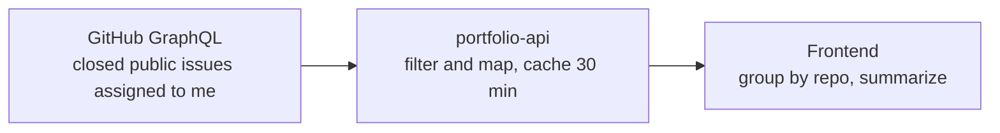
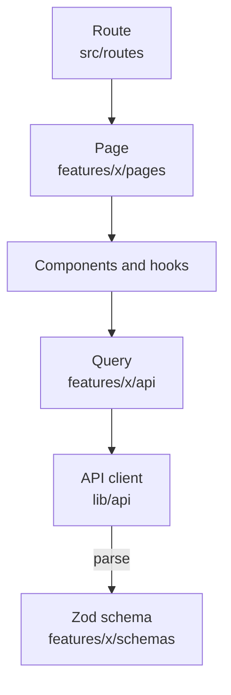
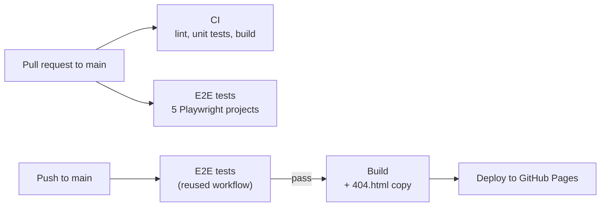

<div align="center">

# Personal Portfolio

A React portfolio with an admin dashboard, live GitHub data on project pages, a page of resolved open-source issues, a Microsoft Store app directory, and a CV generated as a PDF in the browser.


[](https://github.com/Ghifariezra/portfolio/actions/workflows/deploy.yml)

[Live site](https://ezdev.xyz) · [Features](#features) · [Architecture](#architecture) · [Getting started](#getting-started) · [Testing](#testing) · [CI/CD](#cicd)

</div>

---

## Table of contents

- [Personal Portfolio](#personal-portfolio)
  - [Table of contents](#table-of-contents)
  - [Overview](#overview)
  - [Features](#features)
    - [Public pages](#public-pages)
    - [Open-source contributions](#open-source-contributions)
    - [README viewer](#readme-viewer)
    - [CV generator](#cv-generator)
    - [Admin dashboard](#admin-dashboard)
  - [Tech stack](#tech-stack)
  - [Architecture](#architecture)
    - [API surfaces](#api-surfaces)
    - [Caching](#caching)
    - [Admin internals](#admin-internals)
  - [Project structure](#project-structure)
  - [Getting started](#getting-started)
  - [Scripts](#scripts)
  - [Testing](#testing)
    - [What is covered](#what-is-covered)
    - [How the tests get their data](#how-the-tests-get-their-data)
    - [Not covered yet](#not-covered-yet)
  - [Performance and SEO](#performance-and-seo)
  - [CI/CD](#cicd)
    - [Workflows](#workflows)
    - [Branch protection](#branch-protection)
    - [Dependency updates](#dependency-updates)
  - [Conventions](#conventions)

## Overview

This is the frontend of my personal portfolio. It talks to a separate API ([`portfolio-api`](https://github.com/Ghifariezra/portofolio-api): Hono on Cloudflare Workers with Supabase) and validates every response with Zod at runtime, so a change in the API contract shows up in one place instead of breaking the UI quietly.

Content (projects, apps, experience, education, certifications, skills, CV variants) is managed from a built-in admin dashboard rather than hard-coded.

## Features

### Public pages

| Route             | What it shows                                                                                                   |
| ----------------- | --------------------------------------------------------------------------------------------------------------- |
| `/`               | Hero, featured projects, open-source highlights, skills, current role, certifications, contact                  |
| `/about`          | Profile, skills by category, experience, education, certifications, CV download                                 |
| `/projects`       | Project cards with live GitHub stats (stars, forks, top language, last push), filterable by status and language |
| `/projects/:slug` | Highlights and stack, plus GitHub details: README, language bar, contributors, repo stats                       |
| `/apps`           | Windows apps with lifetime install metrics from the Microsoft Store                                             |
| `/contribute`     | Open-source issues I resolved, grouped by repository, each with its closing pull request                        |

Home and About load each section's data independently, so a failing endpoint affects only its own section. The UI is neo-brutalist, with dark mode by default, a theme toggle, a responsive navbar, and a custom 404 page.

### Open-source contributions

The `/contribute` page lists issues in other people's public repositories that were assigned to me and closed, with the pull request that closed each one as evidence.
- **Stats strip:** resolved issues, merged pull requests (counted once per unique PR, since one PR can close several issues), and repositories.
- **Grouped by repository:** name, language, stars, description, and the number of issues. Repositories with the most recent contribution come first.
- **Issue cards:** issue number, close date, who opened it, labels, and the linked pull requests with a merged badge.
- **Home highlight:** the three most recent issues, the same stats, and a link to the full page. The section hides itself when there is nothing to show.

The data comes live from GitHub through the API (`GET /contributions/issues`), not from the database, so nothing is entered by hand.

How the API builds the list:



Things worth knowing:
- Private repositories and issues closed as "not planned" are dropped by the API.
- The API reads up to 100 issues and up to 5 closing pull requests per issue.
- The assignee is configured on the server, so the endpoint cannot be used to query arbitrary GitHub users.

### README viewer

The README of each linked GitHub repository is rendered inside the project page:
- GitHub Flavored Markdown (`react-markdown`, `remark-gfm`) with heading anchors
- Syntax highlighting with Shiki, light and dark themes via CSS variables
- Mermaid diagrams, rendered client-side with `securityLevel: "strict"`; an invalid diagram falls back to a code block
- Folder-structure code blocks shown as a file tree
- Raw HTML is dropped (`skipHtml`), and relative links and images are rewritten to point at the repo on GitHub

### CV generator

The default CV variant is fetched from the API and turned into a PDF in the browser with `@react-pdf/renderer`. The library is imported dynamically, so it is only downloaded the first time the download button is clicked.

### Admin dashboard

Available at `/admin/login` with an admin token.

| Module         | Purpose                                                                                        |
| -------------- | ---------------------------------------------------------------------------------------------- |
| Dashboard      | Per-resource counts and quick links                                                            |
| Profile        | Name, headline, summary, links, avatar                                                         |
| Projects       | Highlights, linked skills, image, GitHub repo, status                                          |
| Apps           | App directory and Store IDs                                                                    |
| Experience     | Work history with bullets and skills                                                           |
| Education      | Education entries                                                                              |
| Certifications | Certifications shown on Home and About                                                         |
| Skills         | Skill catalog with categories                                                                  |
| CV             | Variants (`en` / `id`): pick and order items, mark one as default, preview the resolved result |

## Tech stack

| Area            | Technology                                                                                                    |
| --------------- | ------------------------------------------------------------------------------------------------------------- |
| Framework       | React 19, TypeScript 6                                                                                        |
| Build           | Vite 8                                                                                                        |
| Routing         | TanStack Router (file-based, intent preloading)                                                               |
| Data            | TanStack Query 5 with `queryOptions` factories, native `fetch`                                                |
| Validation      | Zod 4                                                                                                         |
| Styling         | Tailwind CSS v4, `tw-animate-css`, shadcn tokens, `next-themes`                                               |
| Icons and fonts | Phosphor Icons, Inter, Space Grotesk, JetBrains Mono                                                          |
| Content         | `react-markdown`, `remark-gfm`, `rehype-slug`, Shiki, Mermaid                                                 |
| PDF             | `@react-pdf/renderer`                                                                                         |
| Testing         | Playwright (E2E, page object pattern). Vitest and Testing Library are set up, but there are no unit tests yet |
| Quality         | Biome 2 (lint, format, organize imports)                                                                      |
| CI/CD           | GitHub Actions, GitHub Pages, Dependabot                                                                      |

## Architecture

Code is organized by feature. Each feature follows the same layering:



Routes stay thin (SEO `head()`, optional loader, render a page). Queries are `queryOptions` factories with their own keys. The API client does the `fetch`, unwraps the `{ data }` envelope where the endpoint uses one, validates the result, and throws a typed `ApiError`.

Hooks can expose a derived view through `select`. For example, `useContributions` turns the raw issue list into per-repo groups and a summary, so components do not repeat that work.

### API surfaces

| Surface     | Path                                                                    | Auth                            | Used for                                                                   |
| ----------- | ----------------------------------------------------------------------- | ------------------------------- | -------------------------------------------------------------------------- |
| Public data | `/api/v1/public/*`                                                      | none                            | Projects, apps, profile, skills, experience, education, certifications, CV |
| Admin       | `/api/v1/admin/*`                                                       | `Authorization: Bearer <token>` | Dashboard CRUD, including hidden data                                      |
| Live data   | `/projects/:repo`, `/contributions/issues`, `/azure/apps/:id/analytics` | none                            | GitHub repo details, resolved issues, Microsoft Store analytics            |

`/contributions/issues` returns `{ total, issues }` directly, without the `{ data }` envelope used by the public data endpoints.

The API returns errors in two shapes (`{ error: "..." }` and `{ error: { message, details } }`). Both are normalized into `ApiError`, and 422 validation details are mapped to per-field form errors.

### Caching

`staleTime` values in `src/config/cache.ts` follow the cache TTLs documented for the API:

| Data             | Stale time |
| ---------------- | ---------- |
| Portfolio data   | 5 minutes  |
| GitHub repo data | 10 minutes |
| Contributions    | 30 minutes |
| Store analytics  | 60 minutes |
- GitHub data is fetched separately from database data, so a page can still render if GitHub is unavailable. The project list and detail pages use the same query key, so they share a cache entry. The Home highlight and the `/contribute` page share the contributions entry in the same way.
- 4xx errors are not retried; 5xx errors are retried once.
- Admin queries have no `staleTime` and use `cache: "no-store"`.
- After an admin write, the `["admin"]` and `["portfolio"]` queries are invalidated. GitHub queries are left alone.

### Admin internals

- `createAdminResource(path, schema)` produces query keys, list/detail queries, and create, update, delete, replace-bullets, and replace-skills requests, so each admin feature reuses the same pattern.
- `saveResource` saves an entity in up to three requests (main row, bullets, skills). `useResourceForm` handles the case where the main row saved but a later step failed, so a retry sends `PATCH` instead of creating a duplicate.
- The admin token is not a `VITE_*` variable, since those are bundled into the public build. It is entered on the login page, checked against the API, and stored in `sessionStorage` with an in-memory fallback. A `401` clears it and returns you to login. The route guard is a UX convenience; the server is what enforces access.

## Project structure

<details>
<summary>Show the source tree</summary>

```
src/
├── app/                 # providers, query client, router
├── components/
│   ├── layout/          # navbar, nav items, theme toggle, 404
│   ├── markdown/        # markdown renderer, code block, mermaid, file tree
│   └── ui/              # shared primitives
├── config/              # env (API prefixes), cache (stale times), site metadata
├── features/
│   ├── admin/           # shell, login, dashboard, one folder per resource
│   ├── apps/            # app directory and Store metrics
│   ├── contributions/   # resolved issues grouped by repo, stats, issue cards
│   ├── cv/              # PDF document, download button, CV query
│   ├── home/            # home page sections
│   ├── portfolio/       # about page sections
│   └── projects/        # list, filters, detail, GitHub sections, README viewer
├── hooks/               # shared hooks
├── lib/
│   ├── api/             # public client, admin client, typed errors
│   ├── auth/            # admin token store
│   ├── markdown/        # Shiki highlighter, file-tree parser
│   ├── schemas/         # shared Zod schemas
│   ├── utils/           # cn, formatting, url helpers
│   └── seo.ts           # head and meta helpers
├── routes/              # file-based routes (public and admin/_authed/*)
└── styles/              # globals, theme tokens, README styling
```

Inside a feature: `api/` (queries), `components/`, `hooks/`, `lib/` (pure helpers), `pages/`, `schemas/`.

```
tests/
└── e2e/
    ├── fixtures/        # test.extend: one fixture per page (homePage, aboutPage, ...)
    ├── helpers/         # route matchers and mock helpers (api-mocks.ts)
    ├── locators/        # locators per page, based on roles and accessible names
    ├── pages/           # page objects (goto + locators)
    └── specs/           # *.spec.ts, one per page

.github/
├── dependabot.yml       # npm and GitHub Actions updates
└── workflows/           # ci, tests.e2e, deploy, dependabot-auto-merge
```

</details>

## Getting started

**Requirements:** Node.js (LTS) and [pnpm](https://pnpm.io) 10.

```bash
# 1. Install dependencies
pnpm install

# 2. Start the dev server
pnpm dev
```

Then open `http://localhost:5173`.

**API address.** `VITE_API_URL` is optional in development: it defaults to `/api`, which the Vite dev server proxies to a local API at `http://127.0.0.1:8787`, so no CORS setup is needed. To use a deployed API instead, set the variable. For a production build, set it to the Worker URL.

```env
VITE_API_URL=<your-api-url>
```

`pnpm preview` serves the production build, and it also falls back to the `/api` proxy when `VITE_API_URL` was not set at build time. If the local API is not running, requests fail with `ECONNREFUSED`; build with the variable set to preview real data.

**Admin.** Go to `/admin/login` and enter the API's admin token.

## Scripts

| Command                       | Purpose                                                                          |
| ----------------------------- | -------------------------------------------------------------------------------- |
| `pnpm dev`                    | Start the dev server                                                             |
| `pnpm build`                  | Type-check (`tsc -b`), build for production, and add SEO tags to the static HTML |
| `pnpm preview`                | Preview the production build                                                     |
| `pnpm check`                  | Biome: lint, format, organize imports                                            |
| `pnpm lint`                   | Linter only                                                                      |
| `pnpm format`                 | Format files                                                                     |
| `pnpm fix`                    | Auto-fix Biome issues                                                            |
| `pnpm test` / `pnpm test:run` | Vitest in watch mode / a single run                                              |
| `pnpm test:ui`                | Vitest UI                                                                        |
| `pnpm test:e2e`               | Run the E2E tests on all projects                                                |
| `pnpm test:e2e:fast`          | Run the E2E tests on Chromium only                                               |
| `pnpm test:e2e:headed`        | Chromium with a visible browser                                                  |
| `pnpm test:e2e:ui`            | Playwright UI mode                                                               |
| `pnpm test:e2e:report`        | Open the last HTML report                                                        |

## Testing

End-to-end tests use Playwright with the page object pattern. In CI they run against five projects: `chromium`, `firefox`, `webkit`, `mobile-chrome`, and `mobile-safari`.

```bash
# one-time: download browsers
pnpm exec playwright install --with-deps

# fast local run (Chromium only)
pnpm test:e2e:fast

# all five projects
pnpm exec playwright test

# one file, or the interactive UI
pnpm exec playwright test tests/e2e/specs/home.spec.ts
pnpm exec playwright test --ui

# open the last HTML report
pnpm exec playwright show-report
```

Playwright builds and serves the app by itself, so `pnpm dev` does not need to be running. The API address comes from `VITE_API_URL`, which `playwright.config.ts` defaults to the live API. Set the variable to test against another backend. Tests have a 60 second timeout and assertions wait up to 15 seconds, which leaves room for the live API and for Firefox starting cold. The HTML report is written to `playwright-report/`, and failed runs leave traces in `test-results/`.

### What is covered

| Page           | Specs                                                                                                                    |
| -------------- | ------------------------------------------------------------------------------------------------------------------------ |
| Home           | Hero, featured projects, open-source highlights, current role, skills, certifications, contact, and every "see all" link |
| About          | Profile header, experience, education, skills, certifications, and the CV download                                       |
| Projects       | Project list, status filters, opening a project, empty and error states                                                  |
| Project detail | Header and external links, back navigation, 404 and 500 handling, GitHub section fallbacks                               |
| Apps           | App list, external links, Store metrics, and 404 and 502 fallbacks                                                       |
| Contributions  | Header, stats, repository groups, issue cards, link safety, evidence, and empty and error states                         |

The CV download test checks the file name and that the file is a valid PDF. The file is saved under `test-results/` and attached to the HTML report, so you can open it after a run.

### How the tests get their data

- **Happy paths use the real API**, so the data they read must exist: at least one project, app, experience, education entry, skill group, certification, and resolved issue.
- **Empty and error states are mocked** with `page.route`, using the helpers in `tests/e2e/helpers/api-mocks.ts`. This covers 404, 500, and 502 responses without touching the real backend, and external calls (GitHub, Partner Center) never fire in these tests.
- **Some helpers patch a real response** instead of replacing it (for example, forcing the first app to be unpublished). They request the response without `zstd` encoding, because Playwright's Node-side fetch cannot decode it and Firefox would otherwise end up with unreadable JSON.
- **Some tests skip themselves** when the data cannot support them: the status filter needs at least two project statuses, the app-to-project link needs a linked project, and the Store metrics test needs an app that is Live.

### Not covered yet

The admin dashboard, the 404 page, the theme toggle, and the successful GitHub detail view (stats, languages, contributors, README). The contributions success path is only tested against the live API, not against fixed fixture data. `tests/unit/` is empty, so helpers such as the contribution grouping have no unit tests yet.

## Performance and SEO

- **Lazy loading of heavy dependencies:** Mermaid loads only when a README has a diagram, `@react-pdf/renderer` loads on the first CV download, and Shiki loads each language grammar on first use.
- **Router:** routes preload on intent, and the project detail loader fills the same Query cache the page reads from, so the page does not fetch the project twice.
- **Per-route metadata:** title, description, canonical URL, Open Graph, and Twitter Cards through `src/lib/seo.ts`. Project pages use the project's own image and description.
- **Structured data:** JSON-LD `Person` markup on the home page.
- **Crawler tags:** `scripts/prerender-seo.mjs` adds SEO tags to the static HTML. They are removed at startup, after which the router's `head()` manages them.

## CI/CD

### Workflows

Four GitHub Actions workflows, using pnpm 10 and Node LTS.



**CI** (`ci.yml`), on pull requests to `main`
- One job, `check (lint, test, build)`: `pnpm check` (Biome), `pnpm test:run` (Vitest), then `pnpm build` (type-check, build, SEO tags) with `VITE_API_URL` from repository variables.

**E2E Tests** (`tests.e2e.yml`)
- Triggers: pull requests to `main`, manual runs, and calls from the deploy workflow.
- A matrix runs the five Playwright projects in parallel. `fail-fast` is off, so one failure does not hide the results of the others. Each job has a 20-minute timeout.
- The HTML report is uploaded for every run (14 days), and traces on failure (7 days).
- A newer run on the same ref cancels the previous one.

**Deploy to GitHub Pages** (`deploy.yml`)
1. **e2e:** reuses the workflow above.
2. **build:** runs only if e2e passes. It builds with `VITE_API_URL` from repository variables, then copies `404.html` from `index.html` so SPA routing works on Pages.
3. **deploy:** publishes the build.

It runs on pushes to `main` and manual runs. Because deploy depends on e2e, a failing Playwright project blocks the release. A deploy that is already running is not cancelled by a newer push; the next one waits.

**README-only pushes do not deploy.** A push to `main` that touches only `README.md` skips the deploy workflow. Pull requests still run CI and E2E, so required checks always report.

**Dependabot auto-merge** (`dependabot-auto-merge.yml`)
- For Dependabot pull requests whose npm update is a patch, it enables auto-merge. The merge still waits for the required checks.
- Grouped updates mix minor and patch versions, so in practice those pull requests are reviewed and merged by hand.

### Branch protection

`main` is protected by a ruleset: changes go through a pull request, force pushes and deletion are blocked, and these status checks must pass before merging:
- `e2e (chromium)`, `e2e (webkit)`, `e2e (mobile-chrome)`
- `check (lint, test, build)`

`e2e (firefox)` and `e2e (mobile-safari)` run on every pull request but are not required, because they have been the ones to fail when the live API was slow. A failure there still blocks the deploy after merge.

### Dependency updates

Dependabot (`.github/dependabot.yml`) opens pull requests for two ecosystems:

| Ecosystem           | Schedule                            | Grouping                                                                                                                                   |
| ------------------- | ----------------------------------- | ------------------------------------------------------------------------------------------------------------------------------------------ |
| npm (pnpm lockfile) | Weekly, Monday 07:00 (Asia/Jakarta) | Minor and patch updates in one pull request. Major updates are ignored and handled by hand. New releases wait 3 days before being proposed |
| GitHub Actions      | Monthly                             | All action updates in one pull request                                                                                                     |

Commit titles follow Conventional Commits (`chore(deps)`, `chore(deps-dev)`, `chore(ci)`).

Because the build and deploy jobs only run on `main`, an Actions update that touches them is not fully exercised until it is merged. Watch the next deploy after merging one.

## Conventions

- **Biome** is the only linter and formatter. Imports are organized automatically, and each `biome-ignore` comes with a reason.
- **Feature first:** a feature owns its pages, components, hooks, queries, and schemas. Only code shared across features lives in `components/`, `hooks/`, and `lib/`.
- **Validate at the boundary:** responses go through a Zod schema in `lib/api`.
- **One place per concern:** providers in `app/providers.tsx`, nav items in `nav-items.ts` and `admin-nav-items.ts`, stale times in `config/cache.ts`, site metadata in `config/site.ts`.
- **Admin CRUD:** new admin resources use `createAdminResource` and `useResourceForm` instead of copying the pattern.
- **Home sections:** each section is wrapped in `HomeSection`, which provides the title, the "see all" link, and the loading, error, and empty states.
- **Tests:** each page gets one page object, one locators file, and one spec. Locators prefer roles and accessible names over CSS classes, and error or empty states are mocked through the helpers in `tests/e2e/helpers` instead of the real backend.
- **Commits** follow Conventional Commits (`feat`, `fix`, `test`, `chore`, `style`, ...).
- **Changes reach `main` through pull requests**, so CI and E2E run before merging.
